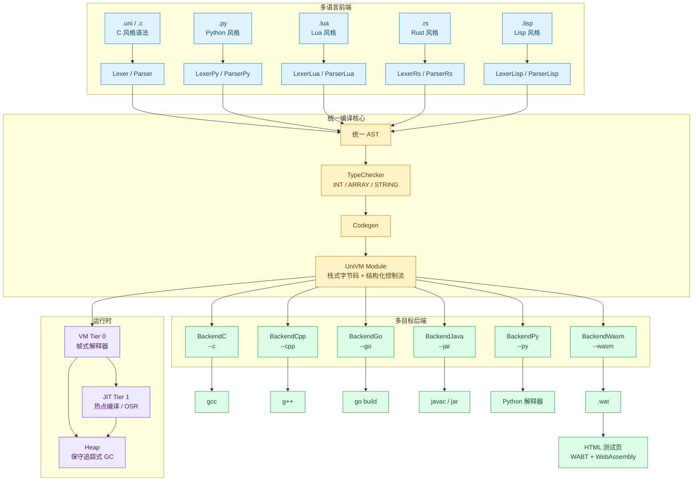

# UniVM

**通用字节码多目标编译器**<br>
*One bytecode. Six language frontends. Six backends. One runtime.*

[](https://github.com/liyinqi1917/Uni_vm/actions/workflows/build.yml)
[](https://adoptium.net/)
[](#支持矩阵)
[](#支持矩阵)

UniVM 是一个以 JVM / GraalVM 为架构参照的通用字节码多目标编译器。它将多种语言风格的源码统一编译到同一套栈式字节码，再由解释器/JIT 执行，或生成 C、C++、Go、JAR、Python、WebAssembly 等目标产物。

它的核心不是“用一个语法支持所有语言”，而是：

> **多语言前端 → 统一 AST → 类型检查 → 统一字节码 → VM/JIT 或多目标后端**

这种结构让新增语言只需实现前端，新增目标平台只需实现后端，而类型系统、控制流、数组/字符串模型、标准库和运行时能力可以在所有链路上复用。

---

## 目录

- [项目简介](#项目简介)
- [架构](#架构)
- [支持矩阵](#支持矩阵)
- [快速开始](#快速开始)
- [运行示例](#运行示例)
- [工程结构](#工程结构)
- [持续集成与发布](#持续集成与发布)
- [路线图](#路线图)
- [贡献与安全](#贡献与安全)

---

## 项目简介

UniVM 面向语言实现、编译原理和运行时工程的学习与研究，同时保持完整的端到端工具链：

- **6 种语言前端**：`.uni`、`.py`、`.c`、`.lua`、`.rs`、`.lisp`
- **6 种后端**：C、C++、Go、JAR、Python、WebAssembly
- **分层执行**：Tier 0 帧式解释器 + Tier 1 热点编译 + OSR 栈上替换
- **统一运行时**：类型检查、数组、字符串、标准库、保守追踪式 GC
- **双入口工具链**：命令行 `Main` + Swing 图形界面 `Gui`
- **WebAssembly 链路**：生成 `.wat` 与可直接在浏览器打开的 HTML 测试页

项目不追求“所有语言特性一次性完备”，而是强调**结构清晰、可验证、可扩展**：每一层都有独立职责，每一个后端都能用同一组示例进行输出一致性验证。

### 设计原则

1. **统一中间表示**<br>
   `Module` 由函数表、`main` 指令序列、字符串池和标准库调用集合组成。所有前端落到同一套栈式指令和结构化控制节点。

2. **执行与生成解耦**<br>
   同一份字节码既可以交给 VM/JIT 直接运行，也可以交给任意后端生成目标代码。

3. **渐进式类型系统**<br>
   当前类型检查覆盖 `INT`、`ARRAY`、`STRING`，并对函数参数、数组下标、标准库签名做静态校验；运行时仍保留必要的动态检查。

4. **工具链完整**<br>
   从编译、运行、字节码查看、性能分析，到 GUI 编辑、后端生成和浏览器测试，均提供可操作入口。

---

## 架构



### 编译流水线

1. **前端**：按源文件扩展名选择 Lexer/Parser，输出统一 AST。
2. **类型检查**：校验作用域、函数参数、数组下标和标准库签名；`--no-check` 时仅做类型推断。
3. **Codegen**：将 AST 降低为栈式字节码，保留 `if/else`、`while` 等结构化控制节点。
4. **执行**：VM 解释执行；热点函数进入 JIT，长循环支持 OSR。
5. **后端**：同一 `Module` 生成 C/C++/Go/Java/Python/WAT，或直接生成浏览器测试页。

---

## 支持矩阵

### 语言前端

| 源文件 | 前端实现 | 语法风格 | 示例 |
| --- | --- | --- | --- |
| `.uni` | `Lexer` / `Parser` | C 风格；`let`、`func`、`if/else`、`while`、数组、字符串 | `examples/test.uni` |
| `.c` | `Lexer` / `Parser` | 与 `.uni` 共用 C 风格语法，作为 `.c` 入口 | `examples/test.c` |
| `.py` | `LexerPy` / `ParserPy` | 缩进块、`def`、`elif`、无分号 | `examples/py_demo.py` |
| `.lua` | `LexerLua` / `ParserLua` | `local`、`print`、表达式 | `examples/test.lua` |
| `.rs` | `LexerRs` / `ParserRs` | `fn main()`、`let mut`、`println!` | `examples/test.rs` |
| `.lisp` | `LexerLisp` / `ParserLisp` | S-expression、前缀运算 | `examples/test.lisp` |

> `.uni` 与 `.c` 共用同一套 C 风格 Lexer/Parser；其余前端分别实现各自的词法与语法入口，最终都落到统一 AST 和字节码。所有控制流前端均支持 `break` / `continue`（Lisp 写成 `(break)` / `(continue)`）。

### 后端

| 后端 | CLI 参数 | 产物 | 依赖 |
| --- | --- | --- | --- |
| C | `--c out` | `out.c` + 可执行文件（工具链可用时） | `gcc` |
| C++ | `--cpp base` | `base.h` + `base.cpp` + 可执行文件（工具链可用时） | `g++ -std=c++17` |
| Go | `--go out.exe` | `gen_main.go` + 可执行文件 | Go 工具链 |
| JAR | `--jar out.jar` | `Gen.java` / `Gen.class` + `out.jar` | JDK |
| Python | `--py out` | `out.py` | Python 解释器（仅运行产物时需要） |
| WebAssembly | `--wasm out` | `out.wat` + `out.html` | 浏览器；HTML 通过 WABT 编译 WAT |

> C/C++ 后端在编译器不可用时会保留源码并给出提示；Go/JAR 后端会调用本机工具链完成构建。所有后端的 `test.uni` 示例输出均为 `50 / 48 / 196`。

### 运行时能力

- **标量**：64 位整数
- **字符串**：字符串常量、`print`、`len`、`+` 拼接、`str(int)`，支持 UTF-8 中文、Emoji 与常见转义序列
- **数组**：`[n]` 分配、下标读写、`len(a)`、数组作为函数参数
- **控制流**：`if/else`、`while`、`break`、`continue`、比较与算术表达式
- **函数**：参数、返回值、递归调用
- **交互输入**：`input()` / `input(prompt)`、`toInt(string)`、`random(min, max)`（闭区间）
- **标准库**：`time()`、`readFile(path)`、`writeFile(path, content)`
- **运行时**：类型检查、Tier 0 解释器、Tier 1 JIT/OSR、保守追踪式 GC

> `input()` 在 CLI 下从标准输入读取一行；在 GUI 下由 `JOptionPane` 弹窗读取。`toInt` 遇到非法输入返回 `0`，`random` 允许 `min > max` 并自动交换边界。

---

## 快速开始

### 环境要求

| 组件 | 说明 |
| --- | --- |
| JDK 21+ | 必需；用于编译和运行 CLI/GUI |
| `gcc` / `g++` | 可选；C/C++ 后端需要 |
| Go | 可选；Go 后端需要 |
| Python | 可选；运行 Python 后端产物需要 |
| 浏览器 | 可选；运行 WebAssembly HTML 测试页需要联网加载 WABT |

以下命令以 Windows CMD / PowerShell 为例。Unix 环境下将路径分隔符 `\` 改为 `/`。

### 1. 一键构建

```bat
build.bat
```

`build.bat` 会执行：

```bat
javac -encoding UTF-8 -d out src\*.java
java -cp out Main example.uni
```

即编译全部 Java 源码到 `out/`，随后运行 `example.uni`，打印字节码和执行结果。

也可以手动构建：

```bat
javac -encoding UTF-8 -d out src\*.java
```

### 2. 使用 CLI

```bat
java -cp out Main examples\test.uni --run
java -cp out Main examples\control.uni --ir
java -cp out Main examples\py_demo.py --profile
```

常用参数：

| 参数 | 作用 |
| --- | --- |
| `--run` | 在 UniVM 中执行 |
| `--ir` | 输出 UniVM 字节码 |
| `--profile` | 输出 JIT/OSR/堆统计 |
| `--no-jit` | 关闭 Tier 1 JIT/OSR |
| `--no-check` | 关闭类型检查（仍做类型推断） |
| `--c/--cpp/--go/--jar/--py/--wasm` | 生成对应后端产物 |

不传后端参数时，`Main` 默认打印字节码并执行。

### 3. 使用 GUI

```bat
java -cp out Gui
```

GUI 工作流：

1. 选择源文件，或直接在代码编辑器中编辑。
2. 选择前端、执行模式和类型检查开关。
3. 选择后端与输出目录。
4. 点击 `Run` 在 UniVM 中运行，或点击 `Generate` 生成后端产物。
5. 程序调用 `input()` 时会弹出 `JOptionPane` 输入框，结果同步回 VM；取消弹窗等价于输入空字符串。
6. 选择 `WASM` 后端时，生成完成后会自动用浏览器打开配套 HTML 测试页。

### 4. 使用 WebAssembly 后端

```bat
java -cp out Main examples\test.uni --wasm out\wasm-demo
```

生成：

```text
out\wasm-demo.wat
out\wasm-demo.html
```

直接打开 `out\wasm-demo.html` 即可在浏览器中查看执行结果：

```bat
start out\wasm-demo.html
```

说明：

- 浏览器不能直接执行 `.wat` 文本，因此 `--wasm` 同时生成 HTML 测试页。
- HTML 页面通过 unpkg 加载 WABT，将 WAT 编译为 WebAssembly 后执行，首次打开需要联网。
- 页面把 `print_int` / `print_str` / `time` / `read_file` / `write_file` / `concat` / `str_int` / `input` / `to_int` / `random` 映射为宿主函数。
- 浏览器文件读写使用页面内存中的虚拟文件系统模拟；`input()` 使用浏览器 `prompt` 弹窗。
- 字符串拼接和 `str(int)` 在宿主侧分配线性内存并复制 UTF-8 字节，因此与 VM/C/C++/Go/JAR/Python 的输出一致。

---

## 运行示例

### 六种语言入口，同一套字节码

```text
> java -cp out Main examples\test.uni --run
50
48
196

> java -cp out Main examples\py_demo.py --run
7
120
3628800
55
3
2
1
5050

> java -cp out Main examples\test.c --run
7
55
3
-3
```

各示例输出：

| 示例 | 输出 |
| --- | --- |
| `examples/test.uni` | `50 / 48 / 196` |
| `examples/py_demo.py` | `7 / 120 / 3628800 / 55 / 3 / 2 / 1 / 5050` |
| `examples/test.c` | `7 / 55 / 3 / -3` |
| `examples/test.lua` | `15` |
| `examples/test.rs` | `15` |
| `examples/test.lisp` | `15` |

这些源码分别经过不同的 Lexer/Parser，但最终共享同一个 Codegen、类型检查器和字节码执行引擎。

### 六个后端，同一份结果

以 `examples/test.uni` 为例：

```text
> java -cp out Main examples\test.uni --jar out\demo.jar
已打包为 jar: out\demo.jar  (运行: java -jar out\demo.jar)

> java -jar out\demo.jar
50
48
196
```

六个后端的输出保持一致：

| 后端 | 命令示例 | 输出 |
| --- | --- | --- |
| C | `--c out\demo-c` | `50 / 48 / 196` |
| C++ | `--cpp out\demo-cpp` | `50 / 48 / 196` |
| Go | `--go out\demo-go.exe` | `50 / 48 / 196` |
| JAR | `--jar out\demo.jar` | `50 / 48 / 196` |
| Python | `--py out\demo` | `50 / 48 / 196` |
| WebAssembly | `--wasm out\demo-wasm` | `50 / 48 / 196`（浏览器测试页） |

完整生成命令：

```bat
java -cp out Main examples\test.uni --c out\demo-c
java -cp out Main examples\test.uni --cpp out\demo-cpp
java -cp out Main examples\test.uni --go out\demo-go.exe
java -cp out Main examples\test.uni --jar out\demo.jar
java -cp out Main examples\test.uni --py out\demo
java -cp out Main examples\test.uni --wasm out\demo-wasm
```

### 验证矩阵

| 示例 | 验证内容 | 输出 |
| --- | --- | --- |
| `examples/test.uni` | 变量、优先级、算术 | `50 / 48 / 196` |
| `examples/control.uni` | `while`、`if/else`、比较 | `10 / 100 / 2 / 1 / 1 / 0` |
| `examples/funcs.uni` | 函数、递归、调用约定 | `7 / 120 / 3628800 / 55` |
| `examples/arrays.uni` | 数组、分配、GC | `30 / 499 / 10` |
| `examples/string_test.uni` | 字符串、`print`、`len` | `Hello UniVM! / 12` |
| `examples/hello_zh.uni` | 中文、转义、`+` 拼接、`str(int)` | `你好，世界！ / 数字是 42，平方是 1764` |
| `examples/break_continue.uni` | `break` / `continue` | `1 / 3 / 5 / 7 / 循环结束` |
| `examples/multiplication.uni` | 嵌套循环、字符串拼接、九九乘法表 | 9 行乘法表 |
| `examples/input_test.uni` | `input`、`toInt`、`random` | 依赖交互输入 |
| `examples/guess_number.uni` | 完整猜数字游戏 | 依赖交互输入，猜中后结束 |
| `examples/stdlib_test.uni` | `time`、`readFile`、`writeFile` | 时间戳 + `Hello from UniVM Standard Library!` |

### 交互式程序

```bat
java -cp out Main examples\input_test.uni --run
java -cp out Main examples\guess_number.uni --run
java -cp out Main examples\multiplication.uni --run
```

`input_test.uni` 会依次读取名字和两个整数；`guess_number.uni` 会随机生成 1–100 的目标并循环提示。也可以把输入重定向到文件，便于自动化测试：

```bat
java -cp out Main examples\input_test.uni --run < input.txt
```

JIT/OSR 基准示例位于 `examples/jit.uni` 和 `examples/osr.uni`；仓库历史记录中 Tier 1 的加速比约为 **2.47x**，OSR 约为 **1.97x**。

---

## 工程结构

```text
UniVM/
├─ src/
│  ├─ Main.java                 # CLI 入口
│  ├─ Gui.java                  # Swing GUI
│  ├─ Lexer.java / Parser.java  # .uni / .c 前端
│  ├─ LexerPy.java ...          # Python / Lua / Rust / Lisp 前端
│  ├─ Ast.java
│  ├─ TypeChecker.java
│  ├─ Codegen.java              # AST -> UniVM Module
│  ├─ Vm.java                   # Tier 0 解释器
│  ├─ Jit.java                  # Tier 1 JIT / OSR
│  ├─ Heap.java / ArrayTypes.java
│  ├─ BackendC.java / BackendCpp.java
│  ├─ BackendGo.java / BackendJava.java
│  ├─ BackendPy.java / BackendWasm.java
│  └─ StringTypes.java
├─ examples/                    # 多语言、多后端示例
├─ build.bat                    # 编译并运行示例
├─ package.ps1                  # 本地 jpackage 打包
├─ release.ps1                  # 发布 zip + SHA256
└─ .github/workflows/build.yml  # GitHub Actions CI
```

---

## 持续集成与发布

### GitHub Actions

`.github/workflows/build.yml` 在 push 到 `main` 时自动执行：

1. 检出源码
2. 安装 JDK 21
3. 编译全部 Java 源码
4. 运行 `examples/test.uni` 做 CLI 冒烟测试

这与本地的基础构建命令保持一致：

```bat
javac -encoding UTF-8 -d out src\*.java
java -cp out Main examples\test.uni --run
```

### 发布脚本

`release.ps1` 用于生成 Windows x64 免安装发布包：

```powershell
.\release.ps1
# 或指定版本
.\release.ps1 -Version 1.1.0
```

脚本会：

1. 编译 `src/*.java` 并生成 `UniVM.jar`
2. 使用 `jpackage --type app-image` 生成自带 Java 运行时的 `UniVM.exe`
3. 把 `src/`、`examples/`、文档和 CLI 启动脚本放入发布目录
4. 生成 `dist/UniVM-<version>-windows-x64.zip`
5. 生成对应的 `.sha256` 校验文件

发布包内容：

```text
UniVM/
├─ UniVM.exe          # GUI 启动器（自带运行时）
├─ univm-cli.bat      # 使用内置 Java 运行时的 CLI 入口
├─ app/               # UniVM.jar
├─ runtime/           # 精简 Java 运行时
├─ src/               # 完整 Java 源码
├─ examples/          # 示例程序
├─ README.md
├─ ARCHITECTURE.md / CHANGELOG.md / SECURITY.md / CODE_OF_CONDUCT.md
├─ README-RELEASE.txt
└─ VERSION.txt
```

要求：Windows x64 + JDK 21（含 `jpackage`）。发布目录 `dist/` 已被 `.gitignore` 忽略，不会污染仓库。

---

## 路线图

- [x] 多语言前端：`.uni`、`.py`、`.c`、`.lua`、`.rs`、`.lisp`
- [x] 统一字节码、类型检查、数组、字符串
- [x] VM + Tier 1 JIT + OSR
- [x] C / C++ / Go / JAR / Python / WebAssembly 后端
- [x] GUI 与 WASM 浏览器测试页
- [x] GitHub Actions 编译 CI
- [ ] 更完整的对象/类模型与精确 GC
- [ ] 更丰富的标准库与跨语言 FFI
- [ ] WASM 二进制输出与 JavaScript 互操作
- [ ] Windows/Linux 双平台 CI 与自动化发布

---

## 贡献与安全

- 提交前至少运行一次 `build.bat` 或 CI 中的编译命令。
- 源码、示例和文档统一使用 UTF-8。
- 请遵守 [CODE_OF_CONDUCT.md](CODE_OF_CONDUCT.md)。
- 安全问题请参考 [SECURITY.md](SECURITY.md)。
- 欢迎通过 Issue 或 Pull Request 提交语言前端、后端和运行时改进。

## 链接

- GitHub: <https://github.com/liyinqi1917/Uni_vm>
- Gitee: <https://gitee.com/liyinqi1971/univm>

---

**UniVM：让不同语言共享同一套编译基础设施。**
